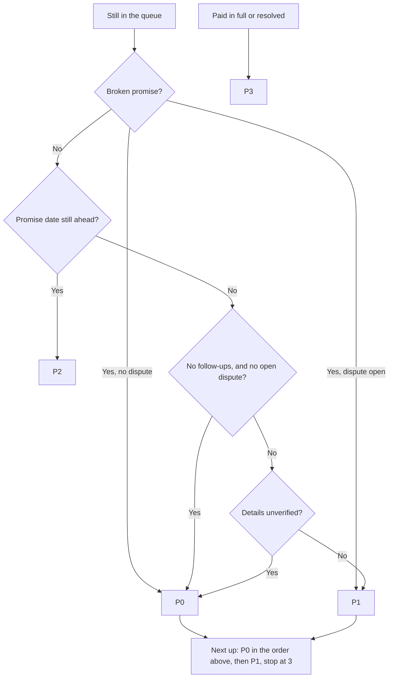

https://github.com/user-attachments/assets/3ee8dcb4-e59f-43d3-ade8-592eed213f12

# Invoice Collections Desk

Morning desk for one finance operator: about half an hour, and three invoices worth opening.

Live: https://invoice-collections-desk.onrender.com/

Repo: [gabrielgiorisatto/invoice-collections-desk](https://github.com/gabrielgiorisatto/invoice-collections-desk)

Demo day is fixed at **2026-11-26**. Age, the due-date window, and whether a promise is broken are all relative to that date. The same calls, shorter, are in [`docs/decisions.md`](docs/decisions.md). The records are in [`docs/adr/`](docs/adr/).

## Buyer

Finance manager at a B2B distributor that sells on credit. They want collectible cash, and a number that separates money from activity, without leaning on accounts that are disputed, promised, or not checked yet.

## User

The finance operator, one person, one sitting. They sign in, work **Next up**, and record what they did. **Logout** clears the session and returns to the sign-in screen.

The account manager is not a second product. **Route to AM** is a labeled simulation on any active invoice. It hands them the next step. It is not a follow-up.

## Outcome

Spend the morning on invoices a person can act on. A follow-up, a promise, and a resolve are work. Cash is a payment the operator recorded.

## What the desk does

Sign in, then:

- **Next up** holds up to three invoices, each with the queue status and a one-line reason.
- **Queue** is the rest of the book: filters, sort, and empty or all-cleared states. **Show paid** brings paid and resolved rows back.
- The **drawer** shows Paid of the invoice total (for example $500 of $3,500), the due date, promise, dispute, details, and the actions. Disabled actions stay on screen, with the reason.
- The **calendar** opens any month and year. Activity is gray. Invoice due, promise, and payment each have their own color.
- **Activity** marks each follow-up **Answered** or **Unanswered**.
- The in-app **Guide** uses the same labels.

A follow-up stays in the queue. It leaves Next up only when priority changes, the invoice leaves the queue, or the due window hides it. Paying what is still unpaid, or resolving, is what takes an invoice out of the queue.

On an active invoice the drawer always allows a follow-up, one promise, one dispute, record payment, resolve without payment, and route to the account manager. Details, promise, and dispute each allow one open item: create it, then update or cancel it. No second one on top. A dispute is allowed after a broken promise, and the broken promise stays.

| Invoice | Also legal |
| --- | --- |
| Brook, open, never contacted | Flag details |
| Dune, broken promise | Cancel the promise |
| Crest, promise still ahead | Cancel the promise |
| Grove, details unverified | Confirm or cancel the details request |
| Aster, open dispute | Cancel the dispute |
| Paid or resolved | None. The always-on actions are off too |

A follow-up is a contact note. It does not verify Grove, and it does not raise that flag.

## How Next up is chosen

Three slots. Fill them from **P0**, in a fixed order, then from **P1**. **P2** and **P3** never take a slot. There is no point total and no pay-likelihood score. The desk shows the tiers as High, Med, Low, and Clear.

P0 order:

1. Broken promise, and no open dispute (Dune)
2. Never contacted, and no open dispute (Brook)
3. Invoice details the customer challenged and nobody has checked (Grove)

A broken promise with an open dispute is P1. It does not take a P0 slot.

On a fresh seed, Next up is Dune, Brook, Grove. East (two unanswered follow-ups, an account manager named) and Aster (open quantity dispute, $12,000) are P1. They enter Next up only when a P0 slot is empty. Aster has more still unpaid, so Aster is the first P1. Crest promised to pay two days after demo day, so Crest is P2 and stays in the queue.

- **Brook.** The first follow-up drops “never contacted.” Brook leaves P0 and becomes P1. Dune and Grove still fill two slots, and Aster takes the third. Brook stays in the queue.
- **Dune.** A follow-up leaves the broken promise in place. Dune stays P0 and stays in the first slot.

Inside P0 the fixed order above wins, so a never-contacted invoice stays ahead of one that only needs a details check. After that, a larger unpaid amount wins, then more days overdue. The queue table uses that same order.



Status is a label. It is separate from the tier. First match wins: Paid (paid amount equals the invoice total), Resolved, Disputed, Broken, Promised, Partial, Needs check, Open. A partial payment does not, by itself, change the tier. Dune can take $500 and stay a broken promise.

## Trade-off

An age sort would chase Aster first: $12,000 and 45 days overdue. This desk does not. Aster is an open quantity dispute, so it is Med and waits behind work a person can do this morning: Dune’s broken promise, Brook’s first contact, and Grove’s details check. Disputed dollars stay out of a cold chase.

## Cash collected versus follow-ups completed

Read the morning as two numbers, not a recovery rate:

- **Cash collected** is the sum of payment amounts the operator recorded. The desk shows it as **Paid total**.
- **Follow-ups completed** is the count of follow-up notes, including the notes already on the seed. The desk does not turn that count into a second total. Each invoice shows its own notes, marked Answered or Unanswered.

That pair is a proposed way to read the demo. It is not measured recovery. The customers are synthetic. Nothing here is reconciled to a bank or a ledger.

A partial payment counts for the amount entered. The invoice shows Paid of its total. Recording $500 against Dune’s $3,500 raises Paid total by $500 and leaves Dune in the queue.

Resolve is not paid. It needs a reason (`dispute_closed`, `credit_issued`, or `other`) and a note. The invoice leaves the queue. Paid total does not change.

A follow-up, a promise, and a route to the account manager do not add to Paid total. Open remaining skips open disputes, so Aster’s $12,000 stays in the table and is not added to that figure.

## Setup

Node 22 or newer. No secrets.

```sh
npm ci
npm test
npm run dev
```

Open http://localhost:5173.

| Username | Password |
| --- | --- |
| `operator` | `demo` |

**Use demo account** fills those fields and signs in. The desk stays on the sign-in screen until this login succeeds. It is a simulation, not real authentication. Invoice routes answer 401 until the cookie exists.

Sign-in sets an HTTP-only cookie, `collections_demo`. The invoice list for that cookie lives in `collections.sqlite` in the working directory (`SQLITE_PATH` overrides the path). Refresh reads the same row. Logout clears the cookie.

`npm start` serves a production build on `PORT` (default 5173). The live service is https://invoice-collections-desk.onrender.com/. `render.yaml` is the host blueprint.

## Checks

[`.github/workflows/ci.yml`](.github/workflows/ci.yml) runs `npm test`, `npm run lint`, and `npm run build` on pull requests and on `main`. `npm run build` typechecks, then builds the client. Vitest covers the domain rules and the API. The workflow does not drive a browser, and it does not call the live URL.

## What we left out

- No bank connection and no payment processing
- No email, SMS, or other reminders
- No ledger or ERP sync
- No legal collections
- No full dispute desk and no account-manager app
- No real accounts, roles, or multi-operator locking
- No model that predicts who will pay

Partial payments are in scope.

## Reviewer walkthrough

On demo day, with the due window on All time:

1. Sign in. Next up is Dune, Brook, and Grove. Aster is in the queue as Med. Crest is Low.
2. Open Aster and Brook. Aster’s suggested action is Route to AM. Brook’s is a first follow-up. Follow-up is still available on Aster. It does not clear the dispute.
3. Record a follow-up on Brook and leave Answered unchecked. Brook leaves Next up and stays in the queue. Activity says Unanswered. Paid total does not move.
4. Record $500 on Dune. The row shows $500 of $3,500. Dune stays a broken promise. Open a dispute on Dune if you want to see it become Med. The broken promise stays.
5. Resolve Crest. Crest leaves the queue. Paid total stays the same. Refresh. Logout returns to the sign-in screen.

## Ownership

Cursor agents drafted the code, the tests, and these notes. The product calls are the author’s: tiers instead of scores, partial payments, resolve distinct from paid, one details check, one promise, and one dispute, route to the account manager on any active invoice, and a morning queue rather than a generic invoice admin.
