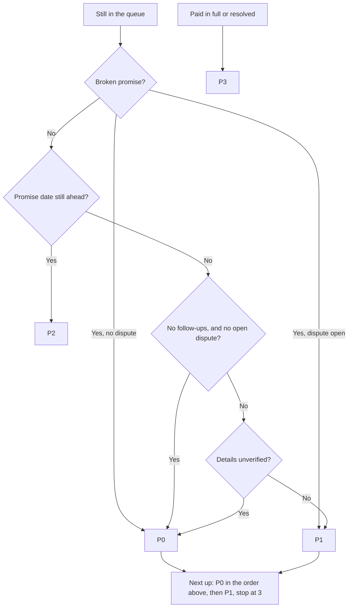

# Invoice Collections Desk

Morning desk for one finance operator: about half an hour, and three invoices worth opening. Public repo: [gabrielgiorisatto/invoice-collections-desk](https://github.com/gabrielgiorisatto/invoice-collections-desk).

Demo day is fixed at **2026-11-26**. Age, the due-date window, and whether a promise is broken are all relative to that date. The same calls, in shorter form, are in [`docs/decisions.md`](docs/decisions.md).

## Buyer

Finance manager at a B2B distributor that sells on credit. They want collectible cash, and a number that separates money from activity, without leaning on accounts that are disputed, promised, or not checked yet.

## User

The finance operator, one person, one sitting. They sign in, work **Next up**, and record what they did. The account manager is a labeled simulation on a dispute, not a second product.

## Outcome

Spend the morning on invoices a person can act on. A follow-up, a promise, and a resolve are work. Cash is a payment the operator recorded.

## Local setup

Node 22 or newer. No secrets. Run it on this machine.

```sh
npm ci
npm test
npm run dev
```

Open http://localhost:5173.

Sign-in sets an HTTP-only cookie, `collections_demo`. The invoice list for that cookie lives in `collections.sqlite` in the working directory (`SQLITE_PATH` overrides the path). Refresh reads the same row.

`npm start` serves a production build on `PORT` (default 5173). `render.yaml` is a blueprint for a later host. This repo does not publish a URL.

## Demo login

The desk stays on the sign-in screen until this login succeeds. It is a simulation, not real authentication. One account:

| Username | Password |
| --- | --- |
| `operator` | `demo` |

**Use demo account** fills those fields and signs in. Invoice routes answer 401 until the cookie exists. Signing out clears the cookie and returns to this screen.

## What we left out

- No bank connection and no payment processing
- No email, SMS, or other reminders
- No ledger or ERP sync
- No legal collections
- No full dispute desk and no account-manager app
- No real accounts, roles, or multi-operator locking
- No model that predicts who will pay

Partial payments are in scope.

## How Next up is chosen

Three slots. Fill them from **P0**, in a fixed order, then from **P1**. **P2** and **P3** never take a slot.

P0 order:

1. Broken promise, and no open dispute (Dune)
2. Never contacted, and no open dispute (Brook)
3. Invoice details the customer challenged and nobody has checked (Grove)

A broken promise with an open dispute is P1. It does not take a P0 slot.

On a fresh seed, Next up is Dune, Brook, Grove. East (two unanswered follow-ups, an account manager named) and Aster (open quantity dispute, $12,000) are P1. They enter Next up only when a P0 slot is empty. Aster’s remaining balance is larger, so Aster is the first P1. Crest promised to pay two days after demo day, so Crest is P2 and stays in the queue.

A follow-up does not remove an invoice. Priority does, and only from Next up. The invoice stays in the queue until it is paid or resolved.

- **Brook.** The first follow-up drops “never contacted.” Brook leaves P0 and becomes P1. Dune and Grove still fill two slots, and Aster, the larger P1, takes the third. Brook stays in the queue.
- **Dune.** A follow-up leaves the broken promise in place. Dune stays P0 and stays in the first slot.

Paying the remaining balance, or resolving, is what takes an invoice out of the queue. Inside P0 the fixed order above wins, so a never-contacted invoice stays ahead of one that only needs a details check. After that, a larger remaining balance wins, then more days overdue. The queue table uses that same order.



## Priority is a tier, not a score

P0–P3 come from the enums on the invoice: promise, dispute, whether anyone has been contacted, whether details are unverified, and whether anything is left to collect. The first matching rule wins. There is no point total and no pay-likelihood score. The desk shows the tiers as High, Med, Low, and Clear.

| Tier | On the desk | Rule |
| --- | --- | --- |
| P0 | High | Broken promise with no open dispute, else never contacted with no open dispute, else unverified details |
| P1 | Med | Still open, and not P0 or P2. Named cases: an open dispute, including one on a broken promise (Aster), or at least two unanswered follow-ups with an account manager (East) |
| P2 | Low | Promise date is still in the future (Crest) |
| P3 | Clear | Remaining is zero, or the invoice was resolved |

That rule is why Aster is not ahead of Brook. An age sort would have chased the $12,000 dispute first.

## Status and actions

Status is a label. It is separate from the tier. First match wins:

| When this is true | Status |
| --- | --- |
| Out of the queue, remaining is zero | Paid |
| Out of the queue for any other reason | Resolved |
| Open dispute | Disputed |
| Broken promise | Broken |
| Promise date still ahead | Promised |
| Some cash recorded, remaining still above zero | Partial |
| Details unverified | Needs check |
| Otherwise | Open |

A partial payment does not, by itself, change the tier. Dune can take $500 and stay a broken promise.

On an active invoice the drawer always allows a follow-up, one promise, one dispute, record payment, resolve without payment, and route to the account manager. The others stay on screen, disabled, with a reason. The server accepts the same set and rejects the rest.

| Invoice | Also legal |
| --- | --- |
| Brook, open, never contacted | Flag details |
| Dune, broken promise | Cancel the promise |
| Crest, promise still ahead | Cancel the promise |
| Grove, details unverified | Confirm or cancel the details request |
| Aster, open dispute | Cancel the dispute |
| Paid or resolved | None. The always-on actions are off too |

A follow-up is a contact note. It does not verify Grove, and it does not raise that flag. One details request: flag it, or confirm or cancel the open one. The invoice stores one promise: record it, update that date, or cancel it. A dispute can be opened when the promise is broken; the broken promise stays. Record payment and resolve without payment stay available together while the invoice is in the queue. Route to the account manager hands them the next step on any active invoice, and the screen calls it a simulation.

## Cash collected versus follow-ups completed

Read the desk as two numbers side by side:

- **Cash collected** is the sum of payment amounts the operator recorded. The desk shows it as **Paid total**.
- **Follow-ups completed** is the count of follow-up notes, including the notes already on the seed.

That pair is a proposed way to read the demo. It is not measured recovery. The customers are synthetic. Nothing here is reconciled to a bank or a ledger.

A partial payment counts for the amount entered. Remaining is the face amount minus the payments on file. Recording $500 against Dune’s $3,500 raises Paid total by $500 and leaves Dune in the queue.

Resolve is not paid. It needs a reason (`dispute_closed`, `credit_issued`, or `other`) and a note. The invoice leaves the queue. Paid total does not change.

A follow-up, a promise, and a route to the account manager do not add to Paid total. Open remaining on the desk skips open disputes, so Aster’s $12,000 stays in the table and is not added to that figure.

Records: [`docs/adr/0001-priority-tiers-not-points.md`](docs/adr/0001-priority-tiers-not-points.md), [`docs/adr/0002-resolve-is-not-paid.md`](docs/adr/0002-resolve-is-not-paid.md), [`docs/adr/0003-proposed-recovery-metric.md`](docs/adr/0003-proposed-recovery-metric.md), [`docs/adr/0004-action-lifecycle.md`](docs/adr/0004-action-lifecycle.md).
